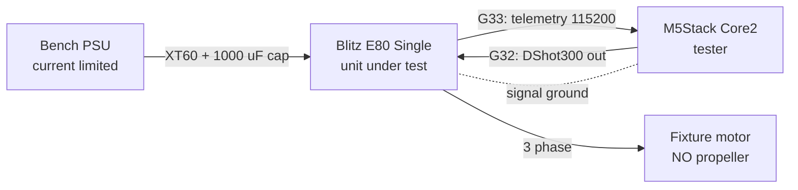
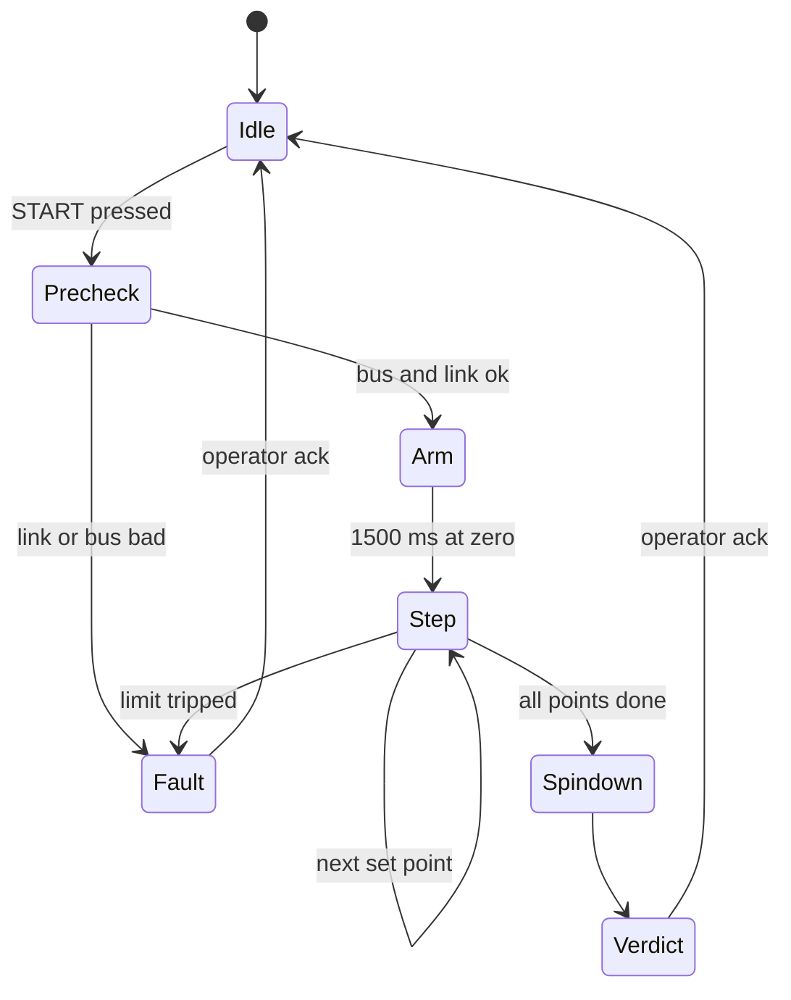

# ESC Tester Specification — M5Stack Core2

As of 2026-09-19

Living version: https://claude.ai/code/artifact/7265e9c6-c5ce-41cc-869d-c2754957bcb0

A bench go/no-go tester for the iFlight Blitz E80 Single ESC. The Core2 commands the ESC over DShot300 to a small number of low throttle set points and reads the ESC's serial telemetry to confirm the motor draws current and the bus voltage is healthy.

## Purpose and scope

The tester answers one question in under a minute: does this ESC drive a motor correctly on a healthy bus? The Core2 commands the ESC over DShot300 to two or three low throttle set points and reads the ESC's own telemetry wire. The ESC passes when, at every set point, telemetry reports bus voltage above 15.0 V, current draw above a minimum threshold, and non-zero eRPM.

In scope:

- Functional go/no-go of one iFlight Blitz E80 Single at a time, on a bench fixture
- DShot300 command generation and KISS-format serial telemetry capture on Port A
- A pass/fail verdict with a single reason code, shown on the Core2 touchscreen

Out of scope:

- Calibrating the ESC's current sensor — telemetry values are taken as reported
- Full-throttle, thermal-soak, or endurance testing
- ESC configuration or firmware flashing (no BLHeli_32 passthrough)
- Judging the motor: the motor is a fixture, not the unit under test

## System overview

The Core2 is the only intelligent device in the loop: it is the DShot master, the telemetry listener, the judge, and the operator interface. It never powers the ESC and never carries motor current.



Reading it: two signal wires and a ground run between Port A and the ESC's servo lead; everything else is power and phases the tester does not touch.

One test run is a fixed sequence — arm at zero throttle, step through the low set points, dwell and sample at each, then stop and report. The whole run takes about 12 seconds. The Core2 emits DShot frames continuously for the entire run, including during the verdict, because BLHeli_32 stops the motor and begins beeping when the signal disappears.

## Hardware under test and test equipment

The unit under test is the [iFlight BLITZ E80 Single](https://shop.iflight.com/BLITZ-E80-Single-ESC-Pro-1797), a BLHeli_32 ESC with an onboard current sensor and no BEC. The no-BEC part matters: the Core2 must be powered from its own USB-C or internal battery, never from the ESC.

| Property | Value | Why it matters here |
| --- | --- | --- |
| Firmware / MCU | BLHeli_32 on STM32G071, 48 MHz | Fixes the telemetry format and the DShot command set |
| Input voltage | 2–8S LiPo (7.4–33.6 V) | Sets the valid bus-voltage window |
| Current | 80 A continuous, 100 A burst | Test currents are <2 % of rating; a high reading means a fault |
| Protocols | DShot150/300/600, MultiShot, OneShot | DShot300 is supported and auto-detected |
| Telemetry | Supported, current sensor onboard | The sole measurement path — no external shunt needed |
| BEC | None | Core2 needs separate power; no 5 V to borrow |
| Capacitance | 420 uF onboard MLCC + supplied 1000 uF 50 V | The external cap must be fitted or the ESC may be damaged |

The tester is an [M5Stack Core2](https://docs.m5stack.com/en/core/core2): a classic dual-core ESP32 at 240 MHz, a 320x240 capacitive touch screen, an AXP192 PMIC, a speaker, a microSD slot, and three Grove ports. Only Port A is used. The ESP32's RMT peripheral generates the DShot waveform in hardware, which is what makes bit-accurate DShot300 practical alongside a touch UI.

The design was written first for the CoreS3, and at this level the two boards are interchangeable — same screen size, same RMT peripheral, same M5Unified API. Three things are not, and each one is a place a straight port goes wrong: Port A is GPIO32/33 rather than GPIO1/2, an RMT memory block is 64 symbols rather than 48, and the touch digitiser is 320x280, extending 40 px below the display over the silkscreened button row.

The bench also needs:

- **Supply** — a current-limited DC bench supply or a charged LiPo. A supply set to 6S nominal (22.2 V) sits comfortably above the 15.0 V pass threshold; see the open question in Verification about 4S. Limit to 10 A and expect capacitor inrush on connection, so use a pre-charge lead.
- **Fixture motor** — any healthy brushless motor rated for the test currents, bolted to a bench mount, **with no propeller fitted**. Its pole count must be recorded, because telemetry reports eRPM, not shaft RPM.
- **Test harness** — a 4-pin Grove lead to the ESC's signal, ground and telemetry wires, described in the next section.

## Electrical interface

Port A on the Core2 breaks out GPIO32 and GPIO33 (normally I2C SDA and SCL), plus 5 V and GND. Both are ordinary GPIOs on the classic ESP32 — neither is a strapping pin, and both are output-capable, which GPIO34..39 are not — so the assignment below is a convention, not a constraint, and swapping the two is a one-line firmware change.

| Grove pin | Core2 signal | Tester use | Connects to |
| --- | --- | --- | --- |
| 1 | GPIO33 (Port A SCL) | UART1 RX, 115200 8N1 | ESC telemetry pad / wire |
| 2 | GPIO32 (Port A SDA) | DShot300 output, RMT TX | ESC signal wire |
| 3 | 5 V | **Not used — leave open** | Nothing. Cut and insulate at the ESC end |
| 4 | GND | Signal ground reference | ESC servo-lead ground (black) |

**Verify the physical pin order with a meter before the first connection.** M5Stack documents Port A as G32 = SDA and G33 = SCL, but confirm which conductor of your Grove lead lands on which pin rather than trusting cable colour. A harness built for a CoreS3 tester is wired the same way round — only the GPIO numbers behind the connector changed.

Design rules that follow from the hardware:

1. **Never connect Port A 5 V to the ESC.** The E80 has no BEC, so there is nothing to power and nothing to receive power from. Power the Core2 from USB-C or its internal battery. On this board the Grove 5 V comes from the AXP192 boost converter, which firmware leaves off (`cfg.output_power = false`).
2. **Ground to the signal ground, not the battery negative.** Use the black wire of the ESC's servo lead so the reference does not share a path with motor current. Keep the ground conductor in the same bundle as the two signals.
3. **Expect pull-ups on both pins.** Port A carries I2C pull-ups to 3.3 V (confirm the value on the Core2 schematic, typically 10 kOhm). On the telemetry line this is helpful — UART idle is high — but do not depend on it being populated: firmware enables the ESP32's internal pull-up on GPIO33 as well, because an unheld RX pin decodes noise as telemetry. On the DShot line the pull-up is not helpful: DShot idles **low**, so firmware must drive GPIO32 low in its earliest init — before `M5.begin()` — and the operator powers the Core2 before the ESC.
4. **Series resistors, close to the Core2.** 100 Ohm in series with GPIO32 damps ringing on the DShot edges; 1 kOhm in series with GPIO33 limits fault current. With a 10 kOhm pull-up, the 1 kOhm still yields about 0.3 V at the pin when the ESC drives low — a valid logic low.
5. **Levels are compatible as-is.** The ESP32 drives 3.3 V CMOS, which the STM32G071 reads as a valid high; the ESC's telemetry output is 3.3 V push-pull, safe for the ESP32. No level shifter is required.
6. **Keep the harness short.** Under 300 mm, signals twisted with ground, routed away from the three phase wires and the battery leads.

Connection order, every time: signal harness first, then ESC power (through a pre-charge lead). Disconnection is the reverse. Never hot-plug the Grove lead while the ESC is powered.

One item to confirm against iFlight's *BLITZ E80 Single ESC Wiring Diagram* before building the harness: which wire in the supplied lead is telemetry, and whether the telemetry connection is a wire or a solder pad on this revision.

## DShot300 signal requirements

DShot300 sends a 16-bit frame as 16 pulses of fixed period and variable high time, MSB first, idling low between frames. At 300 kbit/s one frame occupies 53.3 us. Timings are from the [DShot handbook](https://brushlesswhoop.com/dshot-and-bidirectional-dshot/).

| Parameter | Value |
| --- | --- |
| Bit period | 3.333 us |
| High time for a 1 (T1H) | 2.500 us |
| High time for a 0 (T0H) | 1.250 us |
| Frame length, 16 bits | 53.3 us |
| Idle level between frames | Low |

The RMT peripheral cannot hit 3.333 us exactly from the 80 MHz source, because 800/3 is not an integer number of ticks. Run RMT at 80 MHz resolution (12.5 ns per tick) and use the counts below; the resulting 299.6 kbit/s is 0.12 % slow, far inside what BLHeli_32's bitrate auto-detection accepts.

| Symbol | High ticks | Low ticks | Actual high time | Actual period |
| --- | --- | --- | --- | --- |
| Bit = 0 | 100 | 167 | 1.250 us | 3.3375 us |
| Bit = 1 | 200 | 67 | 2.500 us | 3.3375 us |

### Frame format

The frame is eleven throttle bits, one telemetry-request bit, then a four-bit CRC:

```
SSSSSSSSSSS T CCCC
```

```c
uint16_t dshot_frame(uint16_t throttle11, bool telem_request)
{
    uint16_t value = (throttle11 << 1) | (telem_request ? 1 : 0);   /* 12 bits */
    uint16_t crc   = (value ^ (value >> 4) ^ (value >> 8)) & 0x0F;  /* non-inverted: not bidirectional DShot */
    return (value << 4) | crc;
}
```

Throttle values: 0 means motor stop, 1-47 are special commands, and 48-2047 are the 2000-step throttle range. A set point expressed as a percentage maps to:

```latex
D = 48 + \operatorname{round}\!\left(\frac{p}{100} \times 1999\right)
```

### Transmission discipline

- **Frame rate: 1 kHz, continuous.** A frame every 1000 us leaves the line idle 95 % of the time and is far below the ESC's ceiling. Transmission starts before the ESC is armed and does not stop until the operator ends the run — BLHeli_32 treats signal loss as a fault, stops the motor, and beeps.
- **Telemetry requests: every 10th frame**, giving 100 requests per second. Each request costs the ESC about 870 us of serial airtime (10 bytes at 115200 baud), so 100 Hz leaves comfortable margin. Requesting on every frame would overrun the link.
- **Arming: 1500 ms of DShot 0** before any throttle value. The protocol minimum is about 300 ms; the longer hold also covers the ESC's power-on tones and confirms the signal is stable before anything spins.
- **Ramping: 300 ms linear** between set points, stepped once per frame. This avoids a current spike that could trip the bench supply's limit and be misread as a fault.

### Commands used

| Command | Value | Use in the tester | Constraint |
| --- | --- | --- | --- |
| Motor stop | 0 | Idle, arming, ramp-down, and every abort | Sent continuously whenever not driving |
| Beep 1 | 1 | Optional "ESC detected" chirp before arming | Motor must be stopped; 260 ms minimum between beeps |
| ESC info | 6 | Optional: firmware version to the log | 12 ms minimum wait; response arrives on the telemetry wire |

The tester **must never send commands 7, 8, 12, 20 or 21**. Those change spin direction or write settings to the ESC's flash; a go/no-go tester has no business modifying the unit under test. Guard this in code by rejecting any command value outside {0, 1, 6}.

## ESC telemetry protocol

BLHeli_32 answers each telemetry request with a 10-byte KISS-format frame at **115200 baud, 8N1, non-inverted**. Layout and scaling below follow Betaflight's [esc_sensor.c](https://github.com/betaflight/betaflight/blob/master/src/main/sensors/esc_sensor.c), which is the de-facto reference implementation.

| Byte | Field | Encoding | Unit |
| --- | --- | --- | --- |
| 0 | Temperature | uint8 | degrees C |
| 1-2 | Voltage | uint16, big-endian | 0.01 V |
| 3-4 | Current | uint16, big-endian | 0.01 A |
| 5-6 | Consumption | uint16, big-endian | mAh |
| 7-8 | eRPM / 100 | uint16, big-endian | multiply by 100 for eRPM |
| 9 | CRC8 | over bytes 0-8 | - |

The CRC is CRC-8 with polynomial 0x07, initial value 0x00, MSB-first, no reflection and no final XOR:

```c
static uint8_t crc8_update(uint8_t crc, uint8_t byte)
{
    crc ^= byte;
    for (int i = 0; i < 8; i++) {
        crc = (crc & 0x80) ? (uint8_t)((crc << 1) ^ 0x07) : (uint8_t)(crc << 1);
    }
    return crc;
}
```

Shaft RPM needs the fixture motor's pole count, which the tester stores as a configuration constant:

```latex
\text{RPM} = \frac{\text{raw}_{7:8} \times 100}{N_{\text{poles}} / 2}
```

### Framing and timing

One frame takes about 870 us on the wire, and the tester requests at 100 Hz, so bytes arrive in a tight burst every 10 ms with roughly 9 ms of silence between bursts. Frame the stream on that silence: any gap longer than 3 ms since the previous byte discards the partial buffer and starts a new frame. A buffer that reaches 10 bytes with a matching CRC is a valid sample; anything else increments a bad-frame counter and is dropped.

Three behaviours to design around:

- **A line nobody is driving.** The ESC only answers when asked, and for most of the tester's life nothing is connected to GPIO33 at all. An unheld input picks up enough noise for the UART to decode bytes out of it, and CRC8 admits one random 10-byte sequence in 256 — which then reads as an ESC reporting nonsense. Two measures, because neither is sufficient alone. Hold the pin at the UART idle level with a pull-up, so noise has to beat a held line rather than a floating one; a pull-down would be worse than floating, since a line held low is a start bit that never ends. Then make a frame earn the name: it must arrive as one burst (ten bytes inside 2 ms, against the 868 us a real frame takes), pass the CRC, decode to values an ESC could actually produce, and be one of three such frames in a row no more than `TELEM_GAP_MS` apart before the link counts as up. The plausibility bounds are wide on purpose — they say "an ESC could have sent this", not "this is a good ESC", and a genuinely faulty ESC must still reach the verdict logic as data. One of them is not obvious: voltage must be at least 1.00 V, because ten 0x00 bytes are a CRC-valid frame and a line stuck low delivers exactly that.
- **Auto Telemetry.** If someone has enabled it in BLHeli_32, the ESC streams continuously instead of answering requests, and the 3 ms gap rule stops framing correctly. The tester must not require the setting either way, so fall back to a sliding-window CRC search when three consecutive gap-framed attempts fail. Only well-shaped bursts count toward those three, so noise trickling in a byte at a time cannot push the parser into the sliding window — which is the mode where a false CRC hit is cheapest to come by.
- **Current accuracy at low load.** The BLHeli_32 current reading comes from an onboard shunt and is optimistic-to-noisy near zero — a genuinely spinning motor at 5 % throttle can report a value close to 0.00 A. This directly constrains the pass thresholds, and is the main reason the set points in the next section are not as low as they could be. Set the minimum-current threshold from measurements on known-good units, not from theory.

### Data the tester keeps

Voltage, current and eRPM are the decision inputs. Temperature is recorded and bounded but does not change the verdict on a 12-second run. Consumption is logged and otherwise ignored.

## Test sequence and state machine

A run is a fixed, non-interactive sequence of about 12 seconds. The operator starts it and acknowledges the result; nothing else is under their control except abort, which is available at all times.



| Phase | DShot output | Duration | Exit condition |
| --- | --- | --- | --- |
| Idle | 0, continuous | until START | Operator presses START |
| Precheck | 0, telemetry requested | 500 ms | 30 of 50 frames valid, bus voltage in window, current under 0.5 A, eRPM zero |
| Arm | 0, continuous | 1500 ms | Time elapsed, telemetry still healthy |
| Ramp, per set point | linear 48 to target | 300 ms | Target reached |
| Settle, per set point | target | 500 ms | Time elapsed; these samples are discarded |
| Dwell, per set point | target | 2000 ms | About 200 telemetry samples collected |
| Spindown | target to 48 over 300 ms, then 0 | 800 ms | eRPM under 500 or time elapsed |
| Verdict | 0, continuous | until ack | Operator acknowledges |
| Fault | 0, immediately and continuously | until ack | Operator acknowledges |

### Set points

Three set points, run in ascending order. These defaults are starting values to be trimmed on the bench once the fixture motor is chosen — low enough to be safe and quiet, high enough that the ESC's current sensor resolves the draw.

| Set point | Throttle | DShot value | Purpose |
| --- | --- | --- | --- |
| 1 | 6 % | 168 | Confirms the motor starts and commutates from rest |
| 2 | 10 % | 248 | Confirms current and eRPM both rise with command |
| 3 | 15 % | 348 | Highest point; gives the clearest current reading |

Running a two-point test is a configuration change only: drop set point 2 and the monotonicity check in Pass criteria still holds with the remaining pair.

### Timeouts

- **Telemetry gap** — no valid frame for 250 ms in any phase after Precheck: abort to Fault. Suspended for `CMD_TELEM_GRACE_MS` after a DShot special command: BLHeli_32 plays the beep by pulsing the motor and stops answering while it does, and an interruption the tester asked for is not a fault on the ESC.
- **Run watchdog** — a run exceeding 30 s from START: abort to Fault. Catches a state machine that has stalled.
- **Spindown** — eRPM still above 500 after 2 s at DShot 0: abort to Fault and hold at 0.

## Pass and fail criteria

The verdict is PASS only when every check below holds at every set point. Each check runs against the **median** of the samples collected during that set point's 2000 ms dwell — the median rejects the single-frame spikes the ESC's current sensor produces without needing a filter.

| Check | Threshold | Applied to |
| --- | --- | --- |
| Bus voltage, lower | >= 15.0 V | Median of every dwell |
| Bus voltage, upper | <= 34.0 V | Median of every dwell |
| Bus sag | <= 2.0 V below the Precheck median | Every dwell |
| Current, lower | >= 0.20 / 0.35 / 0.60 A at set points 1 / 2 / 3 | Median of each dwell |
| Current, upper | <= 12.0 A | Median of every dwell |
| eRPM, lower | >= 1000 eRPM | Median of every dwell |
| eRPM monotonic | each set point at least 10 % above the previous | Medians, compared across dwells |
| Telemetry health | >= 80 % of requested frames valid (160 of 200) | Each dwell, counted separately |
| ESC temperature | <= 60 degrees C, rise <= 15 degrees C over the run | Every sample |

The three checks that carry the user's original requirement are the voltage floor, the current floor, and the eRPM floor. The eRPM floor is the one that actually proves the motor turned: current alone can flow into a stalled or mis-commutating motor, and a stalled motor draws *more* current, not less.

**The 15.0 V floor needs a decision.** It is comfortable on 6S (22.2 V nominal, 25.2 V charged) but sits above 4S nominal (14.8 V), so a 4S pack would fail the moment it came off full charge. Either fix the supply at 6S or raise nothing and lower the floor to about 13.0 V; the value is a configuration constant either way.

### Reason codes

A failing run reports exactly one code — the first one triggered, evaluated in the order below. The code, not just the word FAIL, goes on the screen and into the log.

| Code | Meaning | Most likely cause |
| --- | --- | --- |
| `E01` | No telemetry at all during Precheck | Telemetry wire, ground, or a dead ESC |
| `E02` | Pre-existing load or motion at Precheck | Motor already turning, or a shorted phase |
| `E03` | Bus voltage below floor | Supply set too low, or a wrong pack |
| `E04` | Bus voltage above ceiling | Wrong supply; stop before arming |
| `E05` | Bus sag beyond limit | Supply current limit, thin leads, or missing cap |
| `E06` | No current at a set point | ESC not driving, or open phase |
| `E07` | Over-current at a set point | Shorted winding, dragging bearing, or a prop left on |
| `E08` | No rotation at a set point | Desync, damaged phase, or seized motor |
| `E09` | eRPM did not rise with command | Partial desync or a failing gate driver |
| `E10` | Telemetry dropouts during a dwell | Wiring noise, marginal ground, or ESC MCU fault |
| `E11` | Over-temperature | Genuine thermal fault at very low load |
| `E12` | Timeout or watchdog | Tester or ESC stopped responding |
| `E13` | Operator abort | Not an ESC verdict; logged as a void run |

## Safety and fault handling

The fixture spins an unguarded motor on a bus that can deliver tens of amps, so the safety design is deliberately layered and does not depend on the firmware behaving.

### Bench rules

- **No propeller, ever.** The tester has no way to detect one. A prop on the fixture at 15 % throttle is a serious injury risk and will also fail the run on over-current.
- Motor bolted to a fixed mount, phase leads strain-relieved, nothing loose within the swept area.
- ESC on a non-conductive surface with its heatsink clear; the supplied 1000 uF capacitor fitted.
- Bench supply current limit set to 10 A. This is an independent layer — it protects the bench when the firmware does not.
- The **XT60 or supply switch is the real emergency stop.** The touchscreen is a convenience, not a safety device.

### Firmware fault response

Every abort does the same thing: set the DShot value to 0 on the very next frame and keep transmitting 0. The signal is never stopped as a way of stopping the motor, because that leaves the ESC in an unknown state and starts its signal-loss beeping.

| Trip | Threshold | Response |
| --- | --- | --- |
| Instantaneous over-current | > 20.0 A on 3 consecutive samples | Abort to Fault, code `E07` |
| Instantaneous over-temperature | > 80 degrees C on any sample | Abort to Fault, code `E11` |
| Over-voltage at Precheck | > 34.0 V | Refuse to arm, code `E04` |
| Telemetry gap | no valid frame for 250 ms, outside the post-command grace | Abort to Fault, code `E10` |
| Run watchdog | 30 s since START | Abort to Fault, code `E12` |
| Operator STOP | touch | Abort to Fault, code `E13` |

A Fault never clears itself. The operator must acknowledge before the tester will accept another START, and the acknowledgement is logged.

### Failure modes of the tester itself

The safe behaviour here is inherited rather than engineered, which is worth stating plainly so nobody "fixes" it later:

- **Firmware crash or reset.** GPIO32 goes high-impedance and Port A's pull-up holds the line high. The ESC sees no valid frames, times out, and stops the motor. Signal loss is a safe failure.
- **DShot task starvation.** If the 1 kHz frame timer misses more than 5 consecutive deadlines, the run aborts to Fault. If it stops entirely, the case above applies.
- **Touchscreen failure.** STOP becomes unavailable; the supply switch remains. This is why the supply switch is designated the emergency stop.
- **A stray press on the button row.** The Core2's digitiser covers the 40 px strip below the glass, and START and STOP both live at the bottom of the screen. Coordinates below the display are dropped rather than handed to LVGL, so a press there cannot start or abort a run.

### Leaving the ESC armed

Idle keeps sending DShot 0, which keeps the ESC armed and silent. It also keeps the telemetry bit going out on every tenth frame, and that is not optional: BLHeli_32 answers requests, it does not stream on its own unless Auto Telemetry has been enabled. Stop transmitting and the Home screen has no voltage and no link to show, so `IDLE_DISARM_S` defaults to 0 — never stop.

The cost is an ESC that stays armed at the bench indefinitely. That is the same state a disarmed flight controller leaves it in, and throttle is 0 throughout, so the exposure is small; the mitigation is the supply switch, which is the emergency stop in any case. Setting `IDLE_DISARM_S` non-zero restores the original behaviour — after that long in Idle with no operator action, transmission stops, the ESC disarms and beeps as the cue that the bench is no longer driving it, and the next touch resumes both the stream and telemetry.

## Operator interface

The screen is 320x240 and the operator is standing at a bench, often a metre away, so the rule is one job per screen and numbers large enough to read at arm's length. Each screen below is an LVGL screen object; the widget details are in Firmware architecture.

| Screen | Shows | Controls |
| --- | --- | --- |
| Home | Bus voltage, ESC temperature, telemetry link state, run counter, and the bench instruction — *Connect Motor & ESC WITHOUT Propeller and Touch Start* — banded directly above the button it refers to | START, full width across the bottom; long press opens Settings |
| Running | Phase name, set point *n* of 3, progress bar, live V / A / eRPM / degrees C | STOP, full width, red, bottom 70 px |
| Result | PASS or FAIL in full-screen type, reason code if failed, per-set-point table of V / A / eRPM | DONE |
| Fault | Reason code plus one plain-language line of likely cause | ACK |
| Settings | Set points, thresholds, motor pole count, logging on/off | Back, Save |

Layout rules that are requirements, not preferences:

- The STOP target is at least 70 px tall, spans the full width, and is never covered by a dialog, toast or live value.
- Live numerics use a font of 32 px or larger, updated at 10 Hz — not at the 100 Hz sample rate, which is unreadable and wastes redraw time.
- PASS and FAIL are spelled out as words as well as coloured, so the verdict survives a colour-blind operator or a washed-out screen.
- The reason code is shown on the Result screen itself, not behind a tap.
- The no-propeller instruction is on Home, not behind an acknowledgement dialog. It is the last thing between reading the bus voltage and pressing START, and it is placed from the measured height of its own text, so rewording it cannot push a live value under the button.
- Touch coordinates below the 240 px display are discarded. The Core2's digitiser is 320x280 and the extra strip sits over the silkscreened buttons, where a press must not reach the START or STOP target above it.

### Audio

The Core2 speaker carries the verdict when the operator is not looking at the screen: one short beep at START, a rising two-tone on PASS, a long low tone on FAIL or Fault. Optionally, DShot command 1 before arming makes the *ESC* beep, which confirms the signal wire end to end before anything spins.

## Firmware architecture

Build with **pioarduino**, the community fork of the PlatformIO Espressif32 platform, which tracks Arduino-ESP32 3.x on ESP-IDF 5.x. The upstream `platform = espressif32` lags on Arduino 2.x, whose legacy RMT API cannot express these symbols cleanly, so the fork is a requirement rather than a preference. M5Unified and M5GFX handle display, touch, speaker and power; **LVGL 9.x** provides the controls; the DShot and telemetry paths call the IDF drivers directly (`driver/rmt_tx.h`, `driver/uart.h`, `esp_timer.h`).

```ini
[env:m5stack-core2]
platform = https://github.com/pioarduino/platform-espressif32/releases/download/<pin the current release>/platform-espressif32.zip
board = m5stack-core2
framework = arduino
lib_deps =
    m5stack/M5Unified
    lvgl/lvgl@^9.2.0
build_flags =
    -DLV_CONF_INCLUDE_SIMPLE
    -I include
```

### DShot generation

One RMT TX channel on GPIO32, 80 MHz resolution, 64 symbol memory blocks, transmit queue depth 4. The 64 is not free choice: the driver takes whole memory blocks, and a block is 64 symbols on the classic ESP32 against 48 on the S3, so a value carried over from a CoreS3 build is rejected at `rmt_new_tx_channel()`. Each frame is 16 `rmt_symbol_word_t` values built from the tick table in the DShot section, using the built-in copy encoder — no custom encoder is needed. Set `rmt_transmit_config_t.flags.eot_level = 0` so the line returns low after every frame, matching DShot's idle state.

An `esp_timer` periodic callback at 1000 us reads the current throttle value, sets the telemetry bit on every tenth call, encodes, and calls `rmt_transmit()`. The callback never blocks and never touches the display. Frame jitter is irrelevant to DShot — there is no inter-frame timing requirement — so `esp_timer` is preferred over a task loop for its lower overhead.

### Tasks

| Task | Core | Priority | Cadence | Job |
| --- | --- | --- | --- | --- |
| `esp_timer` callback | 1 | timer task | 1 kHz | Encode and queue one DShot frame |
| `telem_task` | 1 | 18 | blocks on UART | Frame, CRC-check, push samples to a queue |
| `control_task` | 1 | 10 | 100 Hz | State machine, trips, set point selection |
| `ui_task` | 0 | 5 | 20 Hz | `M5.update()`, `lv_timer_handler()`, touch |

The display stays on core 0. A full redraw costs well over a millisecond, and letting it share a core with the frame timer is the obvious way to introduce dropouts.

Shared state is deliberately thin: one atomic `uint16_t` holding the current DShot value, written by `control_task` and read by the timer callback, plus a 32-deep FreeRTOS queue of telemetry samples. No mutexes on the hot paths.

### UI stack

LVGL renders through M5GFX rather than its own driver. The flush callback wraps `M5.Display.startWrite()`, `pushImageDMA()` and `endWrite()`; the input device callback reads `M5.Display.getTouch()`.

- **Draw buffers:** two partial buffers of 320 x 24 px, 15.4 kB each, in internal DMA-capable RAM. Do not put them in PSRAM — it roughly halves the flush rate on this board for no benefit at this screen size. Nor make them taller: LVGL's own pool, the draw buffers and every task stack share one DRAM segment on the classic ESP32, and 40-line buffers overflow it at link time. A full-screen redraw is bounded by the SPI transfer, not by how many flushes it takes.
- **Tick and handler:** `lv_tick_inc(1)` from a 1 ms `esp_timer`; `lv_timer_handler()` from `ui_task` at 30 Hz.
- **Threading:** LVGL is not thread-safe. Every LVGL call happens in `ui_task`. Values cross from `control_task` as atomics or through the sample queue, never as direct widget writes.
- **STOP button:** an `lv_button` of at least 70 px height created on `lv_layer_top()`, so no screen change, message box or toast can ever cover it.
- **Live numerics:** `lv_label` widgets refreshed by an `lv_timer` at 10 Hz, independent of the 100 Hz sample rate.

### Modules

| Module | Responsibility |
| --- | --- |
| `dshot` | Frame encoding, CRC, RMT setup, `set_throttle()`, `send_command()`, start/stop |
| `esc_telem` | UART setup, gap framing, CRC8, sample struct, sample queue |
| `test_seq` | The state machine, phase timing, ramps, set point table |
| `verdict` | Per-dwell medians, threshold evaluation, reason code selection |
| `ui` | LVGL screens and widgets, touch targets, audio cues |
| `runlog` | Record assembly, SD write, serial export |

`dshot` and `esc_telem` have no knowledge of the test; `verdict` has no knowledge of the hardware. That split is what makes the verdict logic testable on a host machine with recorded sample data, which is the only practical way to test it without a bench.

## Configuration parameters

Every value the tester behaves by lives in one header. Nothing in this list is a magic number buried in logic.

### Pins and protocol

| Name | Default | Unit | Rationale |
| --- | --- | --- | --- |
| `DSHOT_PIN` | 32 | GPIO | Port A SDA line, Grove pin 2 |
| `TELEM_PIN` | 33 | GPIO | Port A SCL line, Grove pin 1, UART1 RX |
| `DSHOT_RESOLUTION_HZ` | 80000000 | Hz | RMT tick source; gives the 12.5 ns tick |
| `DSHOT_RMT_SYMBOLS` | 64 | symbols | One RMT memory block on the classic ESP32; a frame needs 16 |
| `DSHOT_FRAME_HZ` | 1000 | Hz | Continuous frame rate, 5 % line duty |
| `TELEM_REQUEST_DIVISOR` | 10 | frames | Telemetry bit every 10th frame, so 100 Hz |
| `TELEM_BAUD` | 115200 | baud | Fixed by BLHeli_32 |

### Sequence timing

| Name | Default | Unit | Rationale |
| --- | --- | --- | --- |
| `PRECHECK_MS` | 500 | ms | Enough for 50 telemetry requests |
| `ARM_MS` | 1500 | ms | 5x the protocol minimum; covers power-on tones |
| `RAMP_MS` | 300 | ms | Slow enough to avoid tripping the supply limit |
| `SETTLE_MS` | 500 | ms | Samples discarded; lets current and RPM stabilise |
| `DWELL_MS` | 2000 | ms | About 200 samples, enough for a stable median |
| `SPINDOWN_MS` | 800 | ms | Ramp down then hold at zero |

### Set points and motor

| Name | Default | Unit | Rationale |
| --- | --- | --- | --- |
| `SETPOINT_PCT` | {6, 10, 15} | % throttle | Low, quiet, and still resolvable by the current sensor |
| `MOTOR_POLES` | 14 | poles | Fixture-specific; needed for eRPM to RPM |

### Pass thresholds

| Name | Default | Unit | Rationale |
| --- | --- | --- | --- |
| `V_MIN` | 15.0 | V | The user's nominal floor; see the open question |
| `V_MAX` | 34.0 | V | 8S charged plus margin |
| `V_SAG_MAX` | 2.0 | V | Below Precheck median; catches a weak supply |
| `I_MIN` | {0.20, 0.35, 0.60} | A | Per set point; calibrate on known-good units |
| `I_MAX` | 12.0 | A | Median ceiling for a healthy motor at 15 % |
| `ERPM_MIN` | 1000 | eRPM | Proves rotation, not just current flow |
| `ERPM_RISE_MIN` | 10 | % | Minimum rise between consecutive set points |
| `TELEM_VALID_PCT` | 80 | % | Valid frames required per dwell |
| `TEMP_MAX` | 60 | degrees C | Pass ceiling at this load |
| `TEMP_RISE_MAX` | 15 | degrees C | Rise over the run |

### Trips and watchdogs

| Name | Default | Unit | Rationale |
| --- | --- | --- | --- |
| `I_TRIP` | 20.0 | A | Instantaneous abort, 3 consecutive samples |
| `TEMP_TRIP` | 80 | degrees C | Instantaneous abort, any sample |
| `TELEM_GAP_MS` | 250 | ms | No valid frame for this long aborts the run |
| `FRAME_GAP_MS` | 3 | ms | Silence that marks a telemetry frame boundary |
| `RUN_WATCHDOG_S` | 30 | s | Hard limit from START |
| `CMD_TELEM_GRACE_MS` | 400 | ms | Telemetry-gap watchdog suspended this long after a DShot special command |
| `IDLE_DISARM_S` | 0 | s | Idle time before transmission stops and the ESC disarms; 0 = never, so Idle keeps polling telemetry |

### Telemetry line and frame validation

| Name | Default | Unit | Rationale |
| --- | --- | --- | --- |
| `TELEM_PULLUP` | 1 | - | Hold the RX pin at UART idle; an unheld input decodes noise as bytes |
| `FRAME_SPAN_MAX_US` | 2000 | us | Ten bytes slower than this did not arrive as one burst; a real frame is 868 us |
| `PLAUS_V_MIN` | 1.00 | V | Ten 0x00 bytes pass CRC8; a line stuck low must not read as a frame |
| `PLAUS_V_MAX` | 60.00 | V | Above any pack this bench runs |
| `PLAUS_I_MAX` | 200.00 | A | Above anything the E80 can report |
| `PLAUS_TEMP_MAX` | 150 | degrees C | Above any temperature the ESC survives |
| `PLAUS_ERPM_MAX` | 500000 | eRPM | Above any motor this fixture takes |
| `TELEM_LOCK_FRAMES` | 3 | frames | Valid frames in a row before the link counts as up |

## Results logging

Every run writes one summary line, pass or fail, including aborted runs. A tester that only records failures cannot tell you the failure rate.

The summary file is `/esc_tests/summary.csv` on the microSD card, appended one line per run, with the header written once on creation:

| Column | Source |
| --- | --- |
| `timestamp` | BM8563 RTC, ISO 8601 local time |
| `run_id` | Monotonic counter held in NVS, survives reboot |
| `esc_serial` | Operator-entered on the Home screen; blank if skipped |
| `verdict` | `PASS`, `FAIL` or `VOID` (operator abort) |
| `reason_code` | `E01`-`E13`, blank on pass |
| `v_precheck` | Median bus voltage before arming, V |
| `v_med_1..3`, `i_med_1..3`, `erpm_med_1..3`, `t_max_1..3` | Per set point medians and peak temperature |
| `valid_pct_1..3` | Percentage of requested telemetry frames that passed CRC |
| `config_hash` | CRC32 of the configuration header, so old runs stay interpretable |

When detailed logging is enabled in Settings, the run also writes every sample to `/esc_tests/raw/<date>_<run_id>.csv` — roughly 1200 rows at 100 Hz over a 12 second run, about 40 kB. This is what you need when a unit fails for a reason the summary does not explain.

The same summary line is echoed over USB CDC as it is written, so a PC can capture runs without touching the card.

If no card is present the tester still runs. It keeps the last 20 summary lines in NVS, shows a persistent warning on the Home screen, and flushes them to the card when one is inserted. Losing the log is not a reason to stop testing.

## Verification, risks and open questions

### Proving the tester before trusting it

Bring it up in this order. Each step is cheap and each one removes a whole class of confusion later.

1. **Scope the DShot line with no ESC attached.** Confirm 3.3375 us bit period, 2.5 us and 1.25 us high times, low idle, a frame every 1 ms, and the telemetry bit on every tenth frame. A logic analyser with a DShot decoder will also verify the CRC.
2. **Feed the telemetry parser synthetically.** Drive GPIO33 from a USB-serial adapter with crafted 10-byte frames: correct frames, bad CRC, short frames, back-to-back bursts. Confirm scaling, gap framing and the bad-frame counter. Then leave GPIO33 unconnected for a few minutes with the ESC absent: the link indicator must stay dark and `esc_telem_good()` must stay at zero. That is the check that the line is held and the validation is doing its job.
3. **Unit-test `verdict` on a host.** Replay recorded sample sets and assert one golden pass plus one case per reason code. This needs no hardware and catches most logic errors.
4. **Inject faults on a real ESC.** Disconnect the telemetry wire (expect `E01`), disconnect one phase (`E06` or `E08`), drop the supply below the floor (`E03`). A tester that cannot be made to fail on demand has not been tested.
5. **Run repeatability.** Twenty consecutive runs on a known-good unit must all pass, with current medians inside plus or minus 15 %. That spread also tells you how tight the thresholds can safely be.

### Risks

| Risk | Impact | Mitigation |
| --- | --- | --- |
| Current telemetry is coarse near zero | False `E06` on a good ESC | Calibrate `I_MIN` from known-good units; raise set point 3 if the margin is thin |
| Port A pull-up holds the DShot line high at boot | ESC sees an invalid signal | Drive GPIO32 low in earliest init, ahead of `M5.begin()`; power the Core2 before the ESC |
| Telemetry RX picks up noise with no ESC driving it | Invented readings; a link indicator that means nothing | Internal pull-up on GPIO33, plus burst shape, CRC, plausibility bounds and a three-frame lock before the link counts as up |
| A press on the button row below the screen lands on START | A run begins without the operator meaning to start one | Touch coordinates at or below the 240 px display are dropped before LVGL sees them |
| Production revisions may ship different firmware | Telemetry framing assumptions break | AM32 uses the same KISS frame, but confirm firmware on receipt of each batch |
| Supply current limit trips on inrush or ramp | False `E05` | Pre-charge lead, 300 ms ramp, 10 A limit |
| Fixture motor wears and becomes the variable | Slow drift toward false failures | Record a fixture ID per run; re-baseline periodically against a reference ESC |
| Low-throttle desync on a large motor | False `E08` or `E09` | Validate set points on the actual fixture before fixing the defaults |

### Open questions

- [ ] **Supply voltage.** 15.0 V is comfortable on 6S but above 4S nominal (14.8 V). Fix the bench at 6S, or lower `V_MIN` to about 13.0 V?
- [ ] **Two set points or three?** The spec assumes three; dropping to two is a config change and slightly weakens the monotonicity check.
- [ ] **Fixture motor and pole count**, needed for the eRPM to RPM conversion and for setting `I_MIN`.
- [ ] **Traceability.** Is ESC serial entry wanted, or is this a quick bench check with no per-unit record?
- [ ] **Batch mode.** Should the tester support testing many units in sequence with a running pass/fail tally on screen?

## Sources

- [iFlight BLITZ E80 Single ESC](https://shop.iflight.com/BLITZ-E80-Single-ESC-Pro-1797) — ESC specifications. Its *BLITZ E80 Single ESC Wiring Diagram* PDF still needs to be checked for the telemetry wire identification.
- [M5Stack Core2 documentation](https://docs.m5stack.com/en/core/core2) — Port A pin assignment (G32 = SDA, G33 = SCL), the AXP192 power rails, and internal I2C devices.
- [DShot, the missing handbook](https://brushlesswhoop.com/dshot-and-bidirectional-dshot/) — DShot bit timings, frame format, CRC, command table and arming behaviour.
- [Betaflight `esc_sensor.c`](https://github.com/betaflight/betaflight/blob/master/src/main/sensors/esc_sensor.c) — reference implementation of the KISS / BLHeli_32 telemetry frame, baud rate, scaling and CRC8.
- [pioarduino platform-espressif32](https://github.com/pioarduino/platform-espressif32) — the PlatformIO platform fork used for the build.
